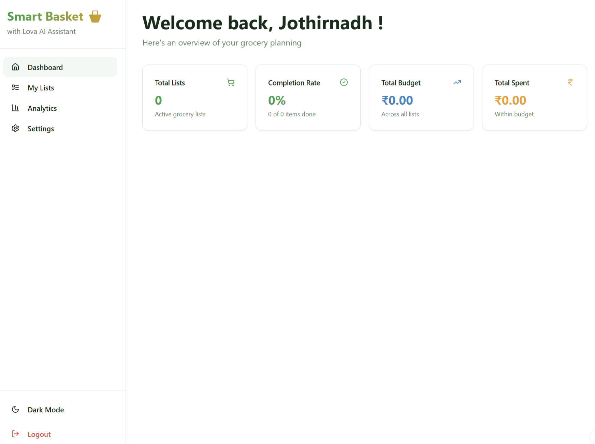
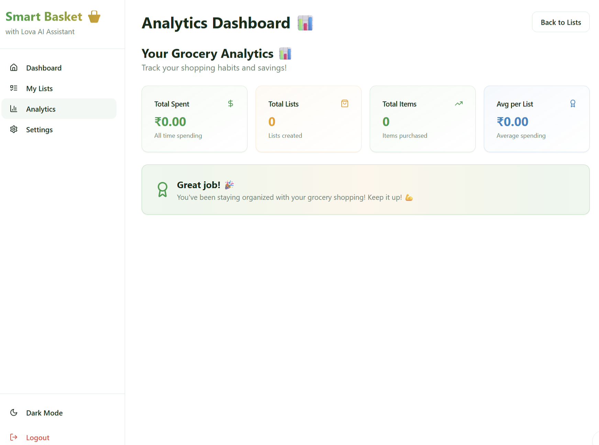

# Smart Basket 🧺

**Smart Basket** is a collaborative grocery-planning app with **Lova**, an AI shopping assistant. Create shopping lists, estimate costs in Indian rupees, track purchases, and share lists with people you shop with.

<p align="center">
  
</p>

<p align="center"><em>Dashboard — an at-a-glance view of grocery-planning activity.</em></p>

## Screenshots

### Dashboard

The dashboard summarizes active grocery lists, item completion, total budget, and spending.

### Analytics Dashboard

<p align="center">
  
</p>

The analytics page summarizes all-time spending, lists created, purchased items, and average spending per list.

> The screenshots show an empty initial state: no lists or items have been recorded, and spending values are ₹0.00. Actual values depend on the data entered in the app.

## Features

- **Account access:** Sign up and sign in with email and password.
- **Grocery lists:** Create lists with optional budgets and shopping dates, then add, update, reorder, complete, or remove items.
- **Shared shopping:** Share a list by email with view-only or edit access. List owners can see and remove shares; collaborators can leave a shared list without deleting it.
- **Lova AI assistant:** Turn meal plans into grocery items, ask general shopping questions, and request nutrition information or lower-cost alternatives. Lova provides cooking instructions only when explicitly asked.
- **Price estimates:** Estimate item prices using broad Indian market assumptions. Estimates are for planning and may not match a particular store or current local prices.
- **Dashboard and analytics:** Review list and item counts, completion, budgets, and spending.
- **Profile settings:** View the account email and update the profile name.
- **Dark mode:** Switch between light and dark appearance.

## Spending and Prices

- Prices are displayed in Indian rupees (₹) with Indian number formatting.
- An item's saved price is the total estimate for its entered quantity and unit. The app does not multiply that saved price by the quantity again.
- **Total Spent** counts completed (purchased) items only.
- **Estimated Total** is for items not yet completed. These measures are kept separate.
- Price estimates are approximate, not live store quotes.

## Technology

- React 18, TypeScript, and Vite
- Tailwind CSS and shadcn/ui
- Lovable Cloud for authentication, database access, and serverless functions
- Zod for input validation
- TanStack Query, React Router, Framer Motion, Recharts, and Lucide icons

## Getting Started

### Requirements

- Node.js and npm
- A configured Lovable Cloud connection for sign-in, list storage, and AI/price functions

### Install and Run Locally

```sh
npm install
npm run dev
```

Vite prints the local development address after startup.

### Available Scripts

```sh
npm run dev       # Start the development server
npm run build     # Create a production build
npm run build:dev # Create a development-mode build
npm run preview   # Preview the production build locally
npm run lint      # Run ESLint
```

The app expects its cloud connection settings to be supplied by the project environment. Do not commit private credentials or API keys.

## Main Pages

| Page | Path | Purpose |
| --- | --- | --- |
| Dashboard | `/` | Overview of lists, budgets, purchases, and completion |
| Sign in | `/auth` | Create an account or sign in |
| My Lists | `/lists` | Browse, create, and share grocery lists |
| List details | `/list/:id` | Manage items in a list and use Lova |
| Analytics | `/analytics` | Explore shopping activity |
| Settings | `/settings` | Update the profile name |

## Serverless Functions

- **`ai-grocery-assistant`** — Handles Lova requests, validates request data, verifies the signed-in user, applies a per-user request limit, and fetches estimates for generated items.
- **`fetch-item-price`** — Returns a broad category-based Indian market estimate for an item and quantity. Estimates are randomly varied and should not be treated as current vendor prices.

## Security and Data Handling

- Authenticated access is required for the AI and price functions. Requests are validated, and per-user rate limits are applied.
- Access to grocery data is governed by database row-level access policies.
- Realtime updates are used for database-change notifications; the app does not use Realtime broadcast or presence channels.
- List-sharing records include the recipient email address so owners can see and manage who they shared a list with. Treat this as personal information.
- Signup requires email verification; leaked-password protection is enabled in the authentication configuration.

## Project Structure

```text
src/
  components/       Shared interface and grocery-list components
  integrations/     Generated Lovable Cloud client and types
  lib/              Formatting, validation, and utility helpers
  pages/            Application pages
supabase/
  functions/        Serverless AI and price-estimation functions
  migrations/       Database schema and policy changes
```

## Deployment

Build the app with:

```sh
npm run build
```

For a Lovable-hosted deployment, publish the project from Lovable so the application and its cloud configuration are deployed together.

## Repository Assets

Keep the screenshots in the `assets/` directory with these filenames so they render correctly on GitHub:

```text
assets/
  dashboard.png
  analytics-dashboard.png
```

---

*Smart Basket makes grocery planning more organized by bringing shopping lists, shared collaboration, estimated prices, and spending insights into one app.*
